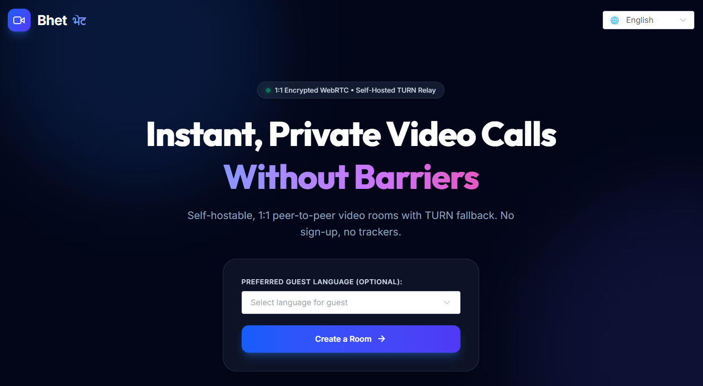

# Bhet (भेट)

> **Bhet** (भेट) is the Nepali word for "meeting" or "encounter".
> A self-hostable, private 1:1 WebRTC video call room with automatic TURN relay fallback, real-time connection quality monitoring, in-call encrypted peer-to-peer text chat, low-bandwidth audio-only mode, and full 7-language internationalization.

<p align="center">
  
</p>

---

## Highlights

- **Zero Sign-Up & Zero Trackers:** Create a room in 1 click; share the guest link; talk immediately.
- **W3C Perfect Negotiation:** Rock-solid WebRTC state machine handling bidirectional offers/answers without race collisions.
- **Self-Hosted TURN Relay:** Coturn integration with HMAC-SHA1 ephemeral credentials ensures calls connect through symmetric NATs, firewalls, and cellular networks.
- **Automated Reconnection:** Automatic ICE restarts on network handovers (e.g., switching from Wi-Fi to cellular 4G/5G).
- **In-Call P2P DataChannel Chat:** Text messages flow directly peer-to-peer via `RTCDataChannel("chat")` without ever touching server disks.
- **Real-Time Quality Metrics:** Live `getStats()` polling measuring round-trip time (RTT), packet loss percentage, and jitter.
- **Adaptive Audio-Only Mode:** One-click toggle capping upstream video bitrate to 32 kbps to maintain voice clarity on weak networks.
- **7-Language Internationalization:** English, Nepali (नेपाली), Hindi (हिन्दी), Spanish (Español), French (Français), Portuguese (Português), and Japanese (日本語) with on-demand Devanagari and Japanese font loading.

---

## Architecture Overview

```
                                      +------------------------------------+
                                      |            Coturn Server           |
                                      |    (STUN :3478 / TURN Relay)       |
                                      +------------------------------------+
                                            ^                        ^
                                            | Ephemeral              | Ephemeral
                                            | Credentials            | Credentials
                                            v                        v
+------------------------+      WebSocket Signaling       +------------------------+
|      Host Browser      | <============================> |     Guest Browser      |
|  - Vue 3 + ElementPlus |          (ws:// / wss://)      |  - Vue 3 + ElementPlus |
|  - Impolite Peer       |                                |  - Polite Peer         |
+------------------------+                                +------------------------+
            \                                                    /
             \========= Direct P2P SRTP Media & DataChannel =====/
                         (Audio, Video, Encrypted Chat)
```

### Backend Architecture (Node.js + Hono + SQLite)
Built using the **MVC + Service** pattern:
- **Models (`src/models/room.model.ts`):** Lightweight SQLite database layer managing room state and 24-hour expirations.
- **Service (`src/room-service.ts`):** Business logic orchestrating room creation, cryptographic token generation, and TURN credential signing.
- **Controllers (`src/controllers/room.controller.ts`):** HTTP endpoints for `POST /api/rooms`, `GET /api/rooms/:id/validate`, and `GET /api/ice-servers`.
- **Signaling Hub (`src/signaling.ts`):** In-memory WebSocket hub routing messages, enforcing strict 2-peer room limits (`ROOM_FULL`), and dispatching presence notifications.

---

## Run in 3 Commands (Docker Compose)

The fastest way to spin up the complete stack with self-hosted TURN:

```bash
# 1. Clone the repository
git clone https://github.com/your-username/bhet.git && cd bhet

# 2. Configure environment
cp .env.example .env

# 3. Launch Bhet and Coturn
docker compose up -d --build
```

Open [http://localhost:3000](http://localhost:3000) in your browser.

---

## Local Development

Requirements:
- Node.js 22 or newer
- [pnpm](https://pnpm.io) 10+

```bash
# Install dependencies across all packages
pnpm install

# Start all applications in watch mode (Server :3000, Web :5173)
pnpm dev
```

### Monorepo Commands (Turborepo)

```bash
# Typecheck TypeScript across all packages
pnpm typecheck

# Run all test suites (Unit, Service, Controller, Signaling, Integration)
pnpm test

# Verify 100% key parity across all 7 translation locales
pnpm check:i18n

# Lint codebase
pnpm lint

# Production build
pnpm build
```

---

## Contributing a New Language

Adding a new language takes 4 simple steps without modifying core application code:

1. Copy `apps/web/src/locales/en.json` to `apps/web/src/locales/<locale-code>.json` (e.g., `de.json`).
2. Translate the string values.
3. Register the locale in `SUPPORTED_LOCALES` in `apps/web/src/i18n.ts`.
4. Run `pnpm check:i18n` to verify key parity.

---

## Documentation

- [`docs/spec.md`](./docs/spec.md) — Complete engineering specification and design principles.
- [`docs/implementation-plan.md`](./docs/implementation-plan.md) — Milestone breakdown and phase deliverables.
- [`docs/webrtc-notes.md`](./docs/webrtc-notes.md) — Deep-dive into ICE candidate trickling, TURN configuration, and network throttling benchmarks.

---

## License

MIT © [Bhet Contributors](https://github.com/your-username/bhet)
